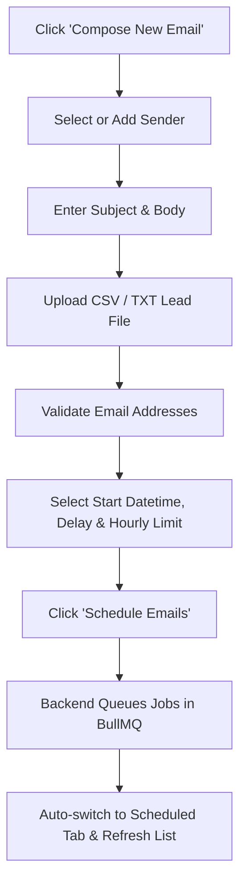

# OutBoxLab — Cold Email Scheduler Frontend

A production-grade, responsive React 18 single-page application for cold email scheduling, campaign tracking, sender management, and Slack notification integration. Built for the ReachInbox assignment following strict feature-based architecture, TypeScript type safety, and clean cold outreach UX.

---

## 📑 Table of Contents
1. [Project Overview & Tech Stack](#1-project-overview--tech-stack)
2. [Frontend Architecture & Folder Structure](#2-frontend-architecture--folder-structure)
3. [Key Features](#3-key-features)
4. [Installation & Setup](#4-installation--setup)
5. [Environment Variables](#5-environment-variables)
6. [Backend API Integration](#6-backend-api-integration)
7. [Google OAuth Setup](#7-google-oauth-setup)
8. [Slack OAuth Integration](#8-slack-oauth-integration)
9. [Loading, Empty & Error States](#9-loading-empty--error-states)
10. [Email Scheduling Flow](#10-email-scheduling-flow)
11. [Testing Checklist](#11-testing-checklist)

---

## 1. Project Overview & Tech Stack

OutBoxLab is a modern email outreach dashboard designed for high deliverability campaigns. It interfaces with an Express + BullMQ + Redis + PostgreSQL (Neon) distributed backend to schedule emails, enforce sender rate limits, and provide real-time updates.

### Tech Stack
- **Framework & Tooling**: [React 18](https://react.dev/) + [Vite](https://vitejs.dev/)
- **Language**: [TypeScript](https://www.typescriptlang.org/) (Strict mode, 0 compile errors)
- **Styling**: [Tailwind CSS v3](https://tailwindcss.com/) (Light-themed cold outreach aesthetic)
- **Routing**: [React Router v6](https://reactrouter.com/) (Protected routes with session guard)
- **Authentication**: [@react-oauth/google](https://www.npmjs.com/package/@react-oauth/google) (Google Identity Services)
- **HTTP Client**: [Axios](https://axios-http.com/) (Centralized instance with interceptors and timeout protection)
- **Icons**: [Lucide React](https://lucide.dev/)
- **Feedback & Notifications**: [react-hot-toast](https://react-hot-toast.com/)

---

## 2. Frontend Architecture & Folder Structure

The frontend is organized using a **feature-first** modular layout to keep code DRY, maintainable, and decoupled:

```
Frontend/
├── public/                 # Favicons and static assets
├── src/
│   ├── components/         # Reusable atomic UI components
│   │   ├── Button.tsx      # Multi-variant button (primary, secondary, danger)
│   │   ├── Header.tsx      # Brand header with user profile avatar & logout
│   │   ├── Loader.tsx      # Spinner loader with fullscreen option
│   │   ├── Modal.tsx       # Accessible modal dialog with backdrop
│   │   ├── ProtectedRoute.tsx # Route guard checking session state
│   │   └── Sidebar.tsx     # Navigation sidebar (Dashboard, Scheduled, Sent, Slack)
│   │
│   ├── context/            # Global application state
│   │   └── AuthContext.tsx # User session, token persistence, and logout handlers
│   │
│   ├── features/           # Domain-driven feature modules
│   │   ├── auth/           # Authentication domain
│   │   │   ├── auth.service.ts   # /api/auth API calls
│   │   │   └── GoogleLogin.tsx   # Google OAuth button wrapper
│   │   │
│   │   ├── emails/         # Email outreach and scheduling domain
│   │   │   ├── AddSenderModal.tsx   # Modal to add Ethereal or custom SMTP senders
│   │   │   ├── ComposeEmail.tsx     # Campaign composer form with CSV parsing
│   │   │   ├── EmailTable.tsx       # Reusable table with Loading/Empty/Error states
│   │   │   ├── email.service.ts     # Senders and campaign scheduling API methods
│   │   │   ├── ScheduledEmails.tsx  # Self-fetching scheduled list (10s auto-refresh)
│   │   │   └── SentEmails.tsx       # Self-fetching sent history list (10s auto-refresh)
│   │   │
│   │   └── slack/          # Integrations domain
│   │       ├── SlackConnect.tsx     # 3-state Slack connection card
│   │       └── slack.service.ts     # Status and disconnect API calls
│   │
│   ├── hooks/              # Custom reusable hooks
│   │   └── useAuth.ts      # Easy hook to access AuthContext
│   │
│   ├── pages/              # View layer / Route pages
│   │   ├── Dashboard.tsx   # Main application hub with tabs & search
│   │   ├── Login.tsx       # Clean Google Sign-In page
│   │   └── NotFound.tsx    # 404 fallback page
│   │
│   ├── services/           # Network infrastructure
│   │   └── api.ts          # Central Axios client with bearer token injection
│   │
│   ├── types/              # TypeScript interface contracts
│   │   ├── email.ts        # Campaign, ScheduledEmail, Sender, CsvParseResult
│   │   └── user.ts         # User session, SlackStatus
│   │
│   ├── App.tsx             # Root router with BrowserRouter & GoogleOAuthProvider
│   └── main.tsx            # DOM root entry
├── .env                    # Environment variables
├── index.html              # HTML shell
├── package.json
├── tailwind.config.js      # Tailwind customization
├── tsconfig.json           # Strict TypeScript compiler options
└── vite.config.ts          # Vite build config
```

---

## 3. Key Features

- **Google OAuth 2.0 Sign-In**: One-click authentication with user profile picture, email, and name displayed in the top header.
- **Persistent User Session**: Safe localStorage token and user hydration with non-blocking session verification (`/api/auth/me`).
- **Compose & Schedule Campaigns**:
  - Multi-sender support (quick 1-click sandbox Ethereal inbox or custom SMTP host/port/credentials).
  - Client-side & server-side CSV/TXT lead list upload with instant validation feedback.
  - Future datetime scheduling, adjustable delays (in seconds/milliseconds), and hourly rate limits.
- **Real-Time Campaign Tracking**:
  - Dedicated **Scheduled Emails** and **Sent Emails** tabs.
  - Automatic background polling every 10 seconds while the active tab is mounted.
  - Single-click cancellation for pending scheduled emails.
- **Elasticsearch Search**: Recipient and subject search bar with live filtering and status badges.
- **Slack Alert Integration**: OAuth connect and disconnect for recipient hourly sending limit alerts.

---

## 4. Installation & Setup

### Prerequisites
- Node.js `v18.0.0` or higher
- Backend running on `http://localhost:5000`

### Step 1: Install Dependencies
```bash
cd Frontend
npm install
```

### Step 2: Configure Environment
Verify `.env` has your backend URL and Google Client ID:
```env
VITE_API_URL=http://localhost:5000
VITE_GOOGLE_CLIENT_ID=your_google_client_id_here.apps.googleusercontent.com
```

### Step 3: Run Development Server
```bash
npm run dev
```
Open **`http://localhost:5173`** in your browser.

### Step 4: Build for Production
```bash
npm run build
```
Creates an optimized production bundle inside `dist/`.

---

## 5. Environment Variables

| Variable | Description | Example |
| :--- | :--- | :--- |
| `VITE_API_URL` | Base URL of the backend REST API | `http://localhost:5000` |
| `VITE_GOOGLE_CLIENT_ID` | OAuth 2.0 Web Client ID from Google Cloud Console | `1098114...apps.googleusercontent.com` |

---

## 6. Backend API Integration

The centralized Axios client in `src/services/api.ts` manages all HTTP communications:

- **Base URL**: Set to `VITE_API_URL` with fallback to `http://localhost:5000`.
- **Bearer Token**: Request interceptor automatically attaches `Authorization: Bearer <token>` from `localStorage`.
- **Session Expiry (401 Interceptor)**: Unauthorizes and redirects to `/login` if token expires.
- **Fail-Fast Timeout**: 15-second timeout avoids hanging forever during cloud database cold starts.

### Primary Endpoints Used
| Method | Endpoint | Description |
| :--- | :--- | :--- |
| `POST` | `/api/auth/google` | Exchange Google ID token for backend JWT & user |
| `GET` | `/api/auth/me` | Fetch active user session profile |
| `POST` | `/api/auth/logout` | Invalidate token and blacklist session |
| `GET` | `/api/senders` | List all configured email senders |
| `POST` | `/api/senders` | Add an Ethereal sandbox or custom SMTP sender |
| `POST` | `/api/emails/parse-csv` | Validate CSV/TXT file and return recipient count |
| `POST` | `/api/emails/schedule` | Schedule batch emails with delay & rate limits |
| `GET` | `/api/emails/scheduled` | List pending and queued emails |
| `GET` | `/api/emails/sent` | List delivered and failed email history |
| `POST` | `/api/emails/:id/cancel`| Cancel a pending scheduled email |
| `GET` | `/api/emails/search?q=` | Elasticsearch query for recipient or subject |
| `GET` | `/api/integrations/slack/status` | Check if workspace Slack webhook is connected |
| `POST` | `/api/integrations/slack/disconnect` | Remove Slack webhook integration |

---

## 7. Google OAuth Setup

1. Open [Google Cloud Console](https://console.cloud.google.com/apis/credentials).
2. Create or select your project and navigate to **APIs & Services > Credentials**.
3. Create an **OAuth 2.0 Client ID** of type **Web application**.
4. In **Authorized JavaScript origins**, add:
   - `http://localhost:5173`
   - `http://localhost`
5. In **Authorized redirect URIs**, add:
   - `http://localhost:5173`
6. Copy the **Client ID** into `Frontend/.env` as `VITE_GOOGLE_CLIENT_ID`.

---

## 8. Slack OAuth Integration

The dashboard includes a dedicated Slack card conforming to the 3-state UX flow:

1. **Checking Status State**: Displays clean status spinner: *"Checking status..."*.
2. **Not Connected State**:
   - Shows Slack logo, *"Not connected"* badge, and a **"Connect Slack"** button.
   - Clicking redirects to `${VITE_API_URL}/api/integrations/slack/connect` to start the OAuth consent flow.
   - On approval, the backend redirects back to `/dashboard?slack=connected` which triggers a green success toast.
3. **Connected State**:
   - Displays green checkmark, *"Connected"* badge, and *"Slack successfully connected"*.
   - Includes a **"Disconnect"** button which issues a `POST /api/integrations/slack/disconnect` call to revoke notifications.

---

## 9. Loading, Empty & Error States

To ensure excellent UX, every major screen implements the 3 mandatory UI states:

### 1. Email Tables (Scheduled & Sent)
- **Loading State**:
  - Centered animated spinner + `"Loading scheduled emails..."` / `"Loading sent emails..."`.
- **Empty State (When no data exists)**:
  - **Scheduled**: Calendar-clock icon + `"No scheduled emails yet"` + `"Your scheduled emails will appear here."` + dark pill button **`[Compose New Email]`**.
  - **Sent**: Envelope icon + `"No sent emails yet"` + `"Your sent emails will appear here."`.
- **Error State**:
  - Red warning circle + `"Unable to load emails. Please try again."` + **`[Retry]`** button.

### 2. Senders Selector (Inside Compose Modal)
- **Fetching**: Spinner + `"Loading senders..."`.
- **No Senders Found**: Informational card + `"No sender accounts added yet"` + **`[+ Add Sender]`** button.
- **Senders Available**: Clean dropdown with Chevron + subtitle: *"Select the email account you want to send from."* + **`+ Add Sender`** link.
- **Error**: Alert banner + `"Unable to load senders."` + **`[Retry]`** button.

---

## 10. Email Scheduling Flow



1. **Sender Selection**: Choose from existing accounts or click **Add Sender** to instantly create a test Ethereal inbox.
2. **Message Composition**: Provide email subject and body template.
3. **Lead List**: Upload `.csv` or `.txt` containing lead emails. Instant badge shows `X emails detected`.
4. **Throttling Parameters**:
   - **Start Time**: Future date and time.
   - **Delay**: Delay between consecutive emails (in seconds, sent as ms to backend).
   - **Hourly Limit**: Max emails sent per sender per hour (triggers Slack alert if exceeded).
5. **Dispatch**: Submits `POST /api/emails/schedule`, closes modal, and refreshes the table.

---

## 11. Testing Checklist

Use this 15-point checklist to verify the full stack integration:

| # | Test Case | Expected Result | Status |
| :-: | :--- | :--- | :-: |
| 1 | **Google Login** | Click "Continue with Google", sign in with account | ✅ |
| 2 | **User Header** | Name, email address, and Google avatar displayed in header | ✅ |
| 3 | **Session Persistence** | Refreshing browser keeps user on dashboard without logout | ✅ |
| 4 | **Logout** | Invalidate backend session and redirect to `/login` | ✅ |
| 5 | **Route Protection** | Accessing `/dashboard` while logged out redirects to `/login` | ✅ |
| 6 | **Dashboard Tabs** | Smooth switching between "Scheduled Emails" and "Sent Emails" | ✅ |
| 7 | **Empty States** | Clean empty illustration with Compose button when list has 0 items | ✅ |
| 8 | **Add Sender Modal** | Quick Ethereal creation or custom SMTP config works | ✅ |
| 9 | **Sender Selector** | Shows dropdown with selected sender & helper text | ✅ |
| 10 | **CSV Upload** | Upload file, verify parsed email counter displays correct count | ✅ |
| 11 | **Delay & Limits** | Delay in ms and hourly limit forwarded to backend payload | ✅ |
| 12 | **Schedule Action** | Submitting campaign adds rows to Scheduled Emails table | ✅ |
| 13 | **Auto-Refresh** | Lists poll every 10 seconds without flickering | ✅ |
| 14 | **Slack Connect** | Redirect to Slack OAuth, returns with connected status | ✅ |
| 15 | **Elasticsearch Search**| Search queries filter emails by recipient or subject | ✅ |
